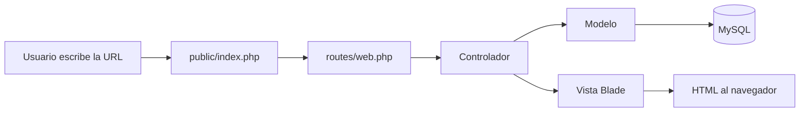
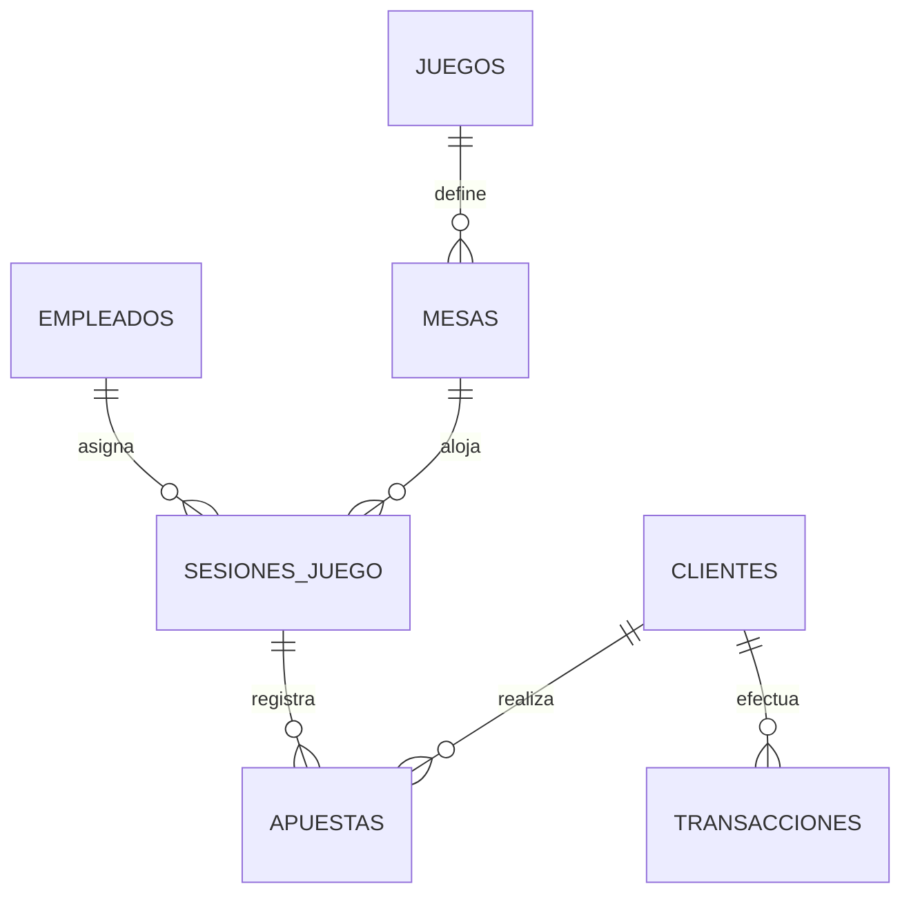

# Casino Fortuna - Sistema de Gestión Empresarial

Proyecto del curso **Software de Gestión Empresarial (COTECNOVA 2026)**.
ERP para un casino / área de juegos de azar, desarrollado con **Laravel** sobre **Docker (Laravel Sail)** y **MySQL**.

**Estado:** primer corte (entorno, autenticación, diseño base y primeras tablas).

---

## Tecnologías

| Componente | Versión / herramienta |
|---|---|
| Framework | Laravel 13 |
| Lenguaje | PHP 8.5 |
| Base de datos | MySQL 8.4 |
| Entorno | Docker + Laravel Sail (WSL2 / Ubuntu) |
| Autenticación | Laravel Breeze (Blade + Alpine.js) |
| Estilos | Tailwind CSS (Vite) |

## Cómo levantar el proyecto

```bash
git clone https://github.com/jamescanos/SoftwareGestionEmpresarial.git
cd SoftwareGestionEmpresarial
cp .env.example .env
./vendor/bin/sail up -d
./vendor/bin/sail composer install
./vendor/bin/sail php artisan key:generate
./vendor/bin/sail npm install && ./vendor/bin/sail npm run build
./vendor/bin/sail php artisan migrate --seed
```

La aplicación queda en `http://localhost:9090` (puerto definido en `APP_PORT`).

---

## Capítulo 1: Entorno de desarrollo

WSL2 con Ubuntu, Docker Desktop y Git configurado con token de acceso personal.
Los archivos del entorno inicial de la Clase 1 (PHP + MariaDB + phpMyAdmin) están en la carpeta `entorno-clase1/`.

---

## Capítulo 2: Instalación de Laravel

### Estructura de carpetas

| Carpeta | Función | En este proyecto |
|---|---|---|
| `app/` | Modelos, controladores y lógica de negocio | `Juego`, `Mesa`, `Cliente`, `MesaController` |
| `bootstrap/` | Arranque del framework | No se modifica |
| `config/` | Configuración (BD, correo, caché) | Sin cambios |
| `database/` | Migraciones, seeders y factories | Tablas del casino y datos de prueba |
| `public/` | Punto de entrada (`index.php`) y assets compilados | CSS/JS generados por Vite |
| `resources/` | Vistas Blade y assets sin compilar | Login, registro, dashboard, mesas |
| `routes/` | Definición de URLs | `web.php`, `auth.php` |
| `storage/` | Logs, caché y sesiones | Generado por Laravel |
| `vendor/` | Dependencias de Composer | No se sube a Git |
| `.env` | Variables de entorno | No se sube a Git |

### Flujo de una petición



Ejemplo real del proyecto: `/mesas` → ruta `mesas.index` → `MesaController@index` → modelo `Mesa` (con su `Juego`) → vista `resources/views/mesas/index.blade.php`.

### Variables de entorno (`.env`)

| Variable | Qué configura | Valor en este proyecto |
|---|---|---|
| `APP_NAME` | Nombre de la aplicación | `Casino Fortuna` |
| `APP_ENV` | Entorno | `local` |
| `APP_DEBUG` | Modo depuración | `true` (solo en desarrollo) |
| `APP_URL` | URL base | `http://localhost:9090` |
| `APP_PORT` | Puerto publicado por Sail | `9090` |
| `APP_LOCALE` | Idioma | `es` |
| `DB_CONNECTION` | Motor de BD | `mysql` |
| `DB_HOST` | Servidor de BD | `mysql` (nombre del servicio Docker, no `localhost`) |
| `DB_PORT` | Puerto de la BD | `3306` |
| `DB_DATABASE` | Nombre de la BD | `laravel` |
| `DB_USERNAME` / `DB_PASSWORD` | Credenciales | Valores por defecto de Sail |

El archivo `.env` está en `.gitignore` y **no se sube al repositorio**; se parte de `.env.example`.

### Patrón MVC aplicado al casino

- **Modelo:** representa los datos (`Juego`, `Mesa`, `Cliente`).
- **Vista:** lo que ve el usuario (`resources/views`).
- **Controlador:** recibe la petición, consulta el modelo y decide qué vista mostrar (`MesaController`).

---

## Capítulo 3: Autenticación y diseño visual

Autenticación con **Laravel Breeze**. Las rutas de los módulos están protegidas con el middleware `auth`: un usuario sin sesión es redirigido a `/login`.

### Cambios visuales realizados

- `layouts/guest.blade.php`: fondo con degradado, tarjeta blanca con borde dorado y logo de texto.
- `auth/login.blade.php` y `auth/register.blade.php`: formularios en español con la misma identidad visual.
- `dashboard.blade.php`: mensaje de bienvenida y tarjetas con indicadores (mesas activas, clientes, fichas en circulación).
- `layouts/navigation.blade.php`: marca del casino y enlaces a los módulos.
- `mesas/index.blade.php`: listado de mesas con estado en color.

### Paleta de colores

| Uso | Color (Tailwind) |
|---|---|
| Fondo de acceso | `red-900` → `gray-900` → `black` |
| Acento principal | `amber-500` / `amber-600` |
| Marca en el menú | `red-700` |
| Estado abierta | `green-100` / `green-700` |
| Estado cerrada | `red-100` / `red-700` |

### Fuentes y recursos

- Tipografía: **Figtree** (Bunny Fonts, incluida en Breeze).
- Iconografía: emoji 🎰 como logo provisional.
- Estilos: Tailwind CSS.

---

## Capítulo 4: Base de datos, modelos y relaciones

### Modelo entidad-relación



| Entidad | Estado |
|---|---|
| `juegos` | Implementada |
| `mesas` | Implementada |
| `clientes` | Implementada |
| `empleados`, `sesiones_juego`, `apuestas`, `transacciones` | Pendiente |

### Tablas implementadas

- **juegos:** `id`, `nombre`, `apuesta_min`, `apuesta_max`, `activo`, `timestamps`
- **mesas:** `id`, `juego_id` (FK → juegos, `onDelete cascade`), `estado`, `timestamps`
- **clientes:** `id`, `documento` (único), `nombre`, `fecha_nacimiento`, `nivel_vip`, `saldo_fichas`, `timestamps`

### Relación 1:N (Juegos → Mesas)

```php
// app/Models/Juego.php
public function mesas() { return $this->hasMany(Mesa::class); }

// app/Models/Mesa.php
public function juego() { return $this->belongsTo(Juego::class); }
```

### Seeders

- `JuegoSeeder`: Blackjack, Póker, Tragamonedas y Bacará (la Ruleta se creó desde Tinker).
- `ClienteSeeder`: 5 clientes de prueba con distintos niveles VIP.

```bash
./vendor/bin/sail php artisan db:seed --class=JuegoSeeder
./vendor/bin/sail php artisan db:seed --class=ClienteSeeder
```

---

## Integrantes

- Completar con los nombres del grupo

---

## Datos del proyecto

- **Proyecto:** Casino Fortuna S.A.S. (empresa simulada) — ERP para un casino: mesas, fichas, clientes, caja, compras, inventario y auditoría.
- **Asignatura:** Software de Gestión Empresarial — COTECNOVA 2026 — **Grupo 9**
- **Docente:** Jhon James Cano
- **Integrantes:** Cristian David Zuleta · Bryan Cárdenas
- **Repositorio:** https://github.com/Pollo-musical-code/SoftwareGestionEmpresarial
- **Versión entregada:** etiqueta `final`

---

## Guía para el docente: cómo ver y ejecutar el proyecto

Hay dos formas de revisarlo. La **Opción A** no instala nada; la **Opción B** lo ejecuta en su computador.

### Opción A — Ver el código y la evidencia directamente en GitHub (sin instalar nada)

1. Abra https://github.com/Pollo-musical-code/SoftwareGestionEmpresarial
2. Para ver exactamente la versión entregada, pulse el menú de ramas (dice `master`), abra la pestaña **Tags** y elija **`final`**.
3. Dónde está cada parte del código:

| Qué busca | Dónde está |
|---|---|
| Reglas de negocio (venta, compra, inventario) | `app/Services/` |
| Controladores y rutas | `app/Http/Controllers/`, `routes/web.php`, `routes/api.php` |
| Roles, rol activo, permisos directos y matriz | `app/Services/AccessControlService.php`, `app/Models/Concerns/HasActiveRole.php`, `app/Http/Controllers/Settings/` |
| API REST v1 (Sanctum) | `app/Http/Controllers/Api/V1/`, `routes/api.php` |
| Excel (exportar / importar con validación) | `app/Exports/`, `app/Imports/` |
| Eventos, listeners y notificaciones | `app/Events/`, `app/Listeners/`, `app/Notifications/`, `app/Observers/` |
| Tarea programada | `app/Console/Commands/EnviarResumenDiario.php`, `routes/console.php` |
| Pruebas automatizadas | `tests/` |
| Integración continua | `.github/workflows/pruebas.yml` y la pestaña **Actions** del repositorio |

4. En la pestaña **Actions** puede ver la ejecución de las pruebas (debe aparecer en verde).

### Opción B — Ejecutarlo en su computador (Docker + Laravel Sail)

No necesita instalar PHP, Composer, MySQL ni Node: todo corre dentro de contenedores Docker.

**Requisitos:** Git y Docker Desktop. En Windows además WSL2 con Ubuntu.

**Solo Windows (una vez):**
1. Abra PowerShell como administrador y ejecute `wsl --install`; reinicie el equipo.
2. Instale Docker Desktop (https://www.docker.com/products/docker-desktop/).
3. En Docker Desktop: *Settings → Resources → WSL Integration* → active **Ubuntu**.
4. Abra la aplicación **Ubuntu** desde el menú Inicio. Todos los comandos siguientes se escriben en esa terminal (en macOS o Linux, en la terminal normal).

**Paso a paso:**

1. Clonar el proyecto (en la carpeta personal, no en `/mnt/c`):
   ```bash
   cd ~
   git clone https://github.com/Pollo-musical-code/SoftwareGestionEmpresarial.git casino
   cd casino
   git checkout final
   ```
2. Instalar las dependencias de PHP usando un contenedor temporal (aún no existe la carpeta `vendor`):
   ```bash
   docker run --rm -u "$(id -u):$(id -g)" -v "$(pwd):/var/www/html" -w /var/www/html \
     laravelsail/php84-composer:latest composer install --ignore-platform-reqs --no-interaction
   ```
3. Crear el archivo de configuración:
   ```bash
   cp .env.example .env
   ```
4. Levantar los contenedores (la primera vez tarda varios minutos porque construye la imagen):
   ```bash
   ./vendor/bin/sail up -d
   ```
5. Generar la llave de la aplicación:
   ```bash
   ./vendor/bin/sail artisan key:generate
   ```
6. Crear las tablas y cargar los datos de demostración (usuarios por rol, juegos, mesas, clientes, fichas, proveedores y kardex inicial):
   ```bash
   ./vendor/bin/sail artisan migrate --seed
   ```
7. Instalar y compilar los estilos:
   ```bash
   ./vendor/bin/sail npm install
   ./vendor/bin/sail npm run build
   ```
8. Abrir en el navegador: **http://localhost:9090** e iniciar sesión con alguno de los usuarios de la tabla siguiente.

**Usuarios de demostración** (contraseña de todos: `password`)

| Rol | Correo | Qué puede hacer |
|---|---|---|
| Administrador | admin@casino.test | Todo, incluida la configuración de usuarios, roles y permisos |
| Supervisor de sala | supervisor@casino.test | Audita, anula ventas, exporta a Excel |
| Cajero | cajero@casino.test | Clientes, venta de fichas, recepción de compras |
| Crupier | crupier@casino.test | Opera las mesas |
| Cajero + crupier | multi@casino.test | Tiene dos roles: al entrar elige su **rol activo** |
| Crupier inactivo | inactivo@casino.test | No puede iniciar sesión (usuario desactivado) |

**Recorrido sugerido (5 minutos):**
1. Entrar como `multi@casino.test`: el sistema pide elegir el rol activo; con *crupier* no aparece Clientes, con *cajero* sí.
2. Entrar como `admin@casino.test` → **Usuarios**, **Roles** y **Matriz de permisos** (menú lateral).
3. **Venta de fichas** → nueva venta → luego anularla; revisar **Kardex de fichas** y **Auditoría**.
4. **Compras de fichas** → recibir una compra (suma al inventario).
5. **Exportar clientes** / **Importar clientes** (hay plantilla descargable).
6. Correos de las alertas: http://localhost:8025 (Mailpit). Para procesar la cola de notificaciones, en otra terminal: `./vendor/bin/sail artisan queue:work`.

**Correr las pruebas automatizadas:**
```bash
./vendor/bin/sail artisan test
./vendor/bin/sail bin pint --test
```

**Probar la API REST** (rutas bajo `/api/v1`):
```bash
curl -s -X POST http://localhost:9090/api/v1/login \
  -H "Accept: application/json" \
  -d "email=cajero@casino.test&password=password"
```
Devuelve un token; úselo con `-H "Authorization: Bearer <token>"` en `GET /api/v1/clientes`, `/fichas`, `/ventas`, `/mesas` y `/me`.

**Detener y limpiar:**
```bash
./vendor/bin/sail down        # detiene los contenedores
./vendor/bin/sail down -v     # además borra la base de datos
```

**Problemas frecuentes**

| Síntoma | Solución |
|---|---|
| `Cannot connect to the Docker daemon` | Abra Docker Desktop y espere a que diga "running". |
| El puerto 9090, 3306 u 8025 ya está en uso | Cierre el programa que lo usa, o cambie `APP_PORT`, `FORWARD_DB_PORT` o `FORWARD_MAILPIT_DASHBOARD_PORT` en `.env` y repita `sail up -d`. |
| `vendor/bin/sail: No such file` | Falló el paso 2; repítalo. |
| Página sin estilos | Repita el paso 7. |
| Quiere reiniciar los datos de demostración | `./vendor/bin/sail artisan migrate:fresh --seed` |
